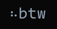

# @alexzzzz/opencode-btw-followups

An OpenCode plugin that gives side questions a thread of their own.

[](https://www.npmjs.com/package/@alexzzzz/opencode-btw-followups)

## What does it do?

The plugin replaces OpenCode's built-in `/btw` with a separate window for side questions. It keeps every question and answer in that window and sends the whole thread with each new question. Follow-up questions build on earlier answers, while your main session stays untouched.

## Why use it?

The built-in `/btw` answers one question, then forgets the exchange. A follow-up starts from scratch. Asking a side question in the main session also adds the question and answer to the session's context and transcript, which is not always what you want.

If you only have one question to ask, the built-in `/btw` is all you need.

## Install, update, and remove

Each block below is self-contained. Copy the block you need.

### Install

```text
Goal: install @alexzzzz/opencode-btw-followups in OpenCode and make /btw use this plugin instead of the built-in command.

Context:
- Package: @alexzzzz/opencode-btw-followups
- OpenCode global config directory: ~/.config/opencode on macOS and Linux, or %USERPROFILE%\.config\opencode on Windows.
- The package is added to opencode.jsonc. The built-in /btw is a plugin named opencode.btw and is controlled by cli.json.
- opencode plugin add does not disable the built-in plugin.

Steps:
1. Run `opencode plugin add @alexzzzz/opencode-btw-followups`.
   Why: installs the package and adds it to the global opencode.jsonc.
2. Open `cli.json` in the global config directory.
   Why: this file controls the built-in TUI plugins.
3. Add `-opencode.btw` to the existing `plugins` array. If it is already there, leave one copy. Keep every other entry.
   Why: the built-in /btw and this plugin answer the same command, and both active at once collide.
   If `cli.json` is missing, create it with:
   {"$schema":"https://opencode.ai/v2/cli.json","plugins":["*","-opencode.btw"]}
4. Run `opencode plugin list`.
   Why: confirms the package is installed and shows its version.
5. Run `opencode api get /api/plugin` and look for `btw-followups` with `"status":"active"`.
   Why: confirms the running OpenCode server loaded the plugin.
6. If the TUI still uses the old /btw, run `/reload` in the TUI.
   Why: reloads plugins without restarting OpenCode.

Success:
- `opencode plugin list` shows `btw-followups` with source `@alexzzzz/opencode-btw-followups`.
- `cli.json` contains `-opencode.btw` exactly once.
- `/btw` opens this plugin's window.

If something fails:
- `opencode` is not found: stop and report that OpenCode is not on PATH.
- `plugin add` fails: report the full error. Do not edit package files by hand.
- `btw-followups` is missing from `opencode plugin list`: inspect the `plugins` array in `opencode.jsonc` and report it. Do not guess or add duplicate entries.
- The plugin is installed but not active: run `/reload`, check again, then report the command output.
- Both /btw interfaces appear: check that `cli.json` contains `-opencode.btw`, then run `/reload`.
```

### Update

```text
Goal: update @alexzzzz/opencode-btw-followups to the latest version and keep the built-in /btw disabled.

Context:
- Package: @alexzzzz/opencode-btw-followups
- OpenCode global config directory: ~/.config/opencode on macOS and Linux, or %USERPROFILE%\.config\opencode on Windows.
- The package is stored in opencode.jsonc. The built-in /btw is disabled by `-opencode.btw` in cli.json.
- Updating the package must not remove or change the built-in switch.

Steps:
1. Run `opencode plugin check @alexzzzz/opencode-btw-followups`.
   Why: asks the registry whether a newer version exists.
2. If the command says the plugin is current, stop and report the current version. If a newer version exists, run `opencode plugin update @alexzzzz/opencode-btw-followups`.
   Why: installs the latest package and updates the global opencode.jsonc.
3. Run `opencode plugin list`.
   Why: confirms the installed version.
4. Check `cli.json` in the global config directory. Keep `-opencode.btw` in the `plugins` array exactly once, and keep every other entry.
   Why: the update must leave the built-in /btw disabled. If the line is missing, add it. If `cli.json` is missing, create it with:
   {"$schema":"https://opencode.ai/v2/cli.json","plugins":["*","-opencode.btw"]}
5. If the TUI still uses the old version, run `/reload` in the TUI.
   Why: reloads plugins without restarting OpenCode.

Success:
- `opencode plugin list` shows `btw-followups` with the new version and source `@alexzzzz/opencode-btw-followups`.
- `cli.json` still contains `-opencode.btw` exactly once.
- `/btw` still opens this plugin's window.

If something fails:
- `plugin check` fails: report the full error. Do not change the installed package.
- `plugin update` fails: report the current and requested versions and the full error. Leave `cli.json` unchanged.
- The version does not change: run `/reload`, check again, then report the output of `opencode plugin list`.
- The built-in /btw appears after the update: check that `cli.json` contains `-opencode.btw`, add it if needed, then run `/reload`.
```

### Remove

```text
Goal: remove @alexzzzz/opencode-btw-followups from OpenCode and restore the built-in /btw.

Context:
- Package: @alexzzzz/opencode-btw-followups
- OpenCode global config directory: ~/.config/opencode on macOS and Linux, or %USERPROFILE%\.config\opencode on Windows.
- `opencode plugin remove` removes the package from opencode.jsonc. It does not re-enable the built-in /btw.
- The built-in /btw is enabled by removing `-opencode.btw` from cli.json.

Steps:
1. Run `opencode plugin remove @alexzzzz/opencode-btw-followups`.
   Why: removes the package from the global opencode.jsonc.
   If the command says the plugin is not installed, continue only if `cli.json` still contains `-opencode.btw`; the remaining goal is to restore the built-in /btw.
2. Open `cli.json` in the global config directory. Remove only `-opencode.btw` from the `plugins` array, and keep every other entry.
   Why: removing this entry lets the built-in /btw load again. If `cli.json` is missing, the built-in /btw is already enabled, so skip this step.
3. Run `opencode plugin list`.
   Why: confirms that `btw-followups` is gone.
4. Check that `cli.json` no longer contains `-opencode.btw`.
   Why: confirms that the built-in /btw can load.
5. If the TUI still uses the plugin window, run `/reload` in the TUI.
   Why: reloads plugins without restarting OpenCode.

Success:
- `opencode plugin list` does not list `btw-followups`.
- `cli.json` does not contain `-opencode.btw`.
- `/btw` opens the built-in command.

If something fails:
- `plugin remove` fails because the plugin is not installed: continue only if `cli.json` has `-opencode.btw`; otherwise report that there is nothing to remove.
- `btw-followups` is still listed with a local path: stop and report the path. Do not delete files or directories without asking.
- `btw-followups` is still listed after a successful remove: report the full output of `opencode plugin list` and the `plugins` array from opencode.jsonc.
- The built-in /btw does not return: check that `-opencode.btw` is gone, run `/reload`, then report the result.
```

## Getting started

In the session prompt, type `/btw` followed by your question:

```text
/btw why does the ci fail on the second test?
```

If you'd rather open the window first, run `/btw` on its own, then type your question inside the window.

### Keyboard shortcuts

From a session, you can use these shortcuts:

1. Press `Ctrl+Up` to open the window.
2. Press `Ctrl+Up` again to open the quick prompts. Use `Up` and `Down` to choose one, then press `Enter`, or click a question.
3. Press `Ctrl+Down` to close the quick prompts.
4. Press `Ctrl+Down` again to close the window.

The same shortcuts work in subagent sessions, so you can ask your subagents side questions, too.


## Working in the window

Ask follow-up questions as you would in a normal chat. Each new question includes the earlier questions and answers, so the model has the context it needs.

Use `PageUp`, `PageDown`, or the mouse wheel to read a long thread. Click one part of an answer to copy that section. To copy the whole thread, use `copy thread`. To clear the thread, press `Delete` twice while the input field is empty.



If you close the window while an answer is being prepared, a `btw` badge appears below the input field. Click it to open the window for that session. You can close the window at any time and come back to it later.

## Things to keep in mind

- **Model and context:** The window uses the same model as your session. Each new question sends the whole side thread, so a long thread uses more context. If your session is already close to its context limit, a side question may fail. Side questions and answers stay out of the session's context and transcript.
- **Tools:** The model cannot use tools in the side window. It cannot read files, run commands, or take other actions. If it tries to use a tool, the answer may fail, and the window shows the question that failed.
- **Storage:** Threads are kept in memory only. They are lost when OpenCode stops or when you delete the session.
- **Terminal:** The window needs a terminal that is at least 15 rows tall.

## License

[WTFPL v2](LICENSE)
