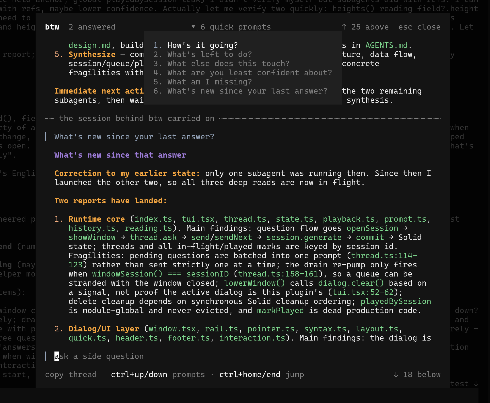

# @alexzzzz/opencode-btw-followups

An OpenCode plugin that gives side questions a thread of their own.

[](https://www.npmjs.com/package/@alexzzzz/opencode-btw-followups)

## What does it do?

The plugin replaces OpenCode's built-in `/btw` with a separate window for side questions. It keeps every question and answer in that window and sends the whole thread with each new question. Follow-up questions build on earlier answers, while your main session stays untouched.

## Why use it?

The built-in `/btw` answers one question, then forgets the exchange. A follow-up starts from scratch. Asking a side question in the main session also adds the question and answer to the session's context and transcript, which is not always what you want.

If you only have one question to ask, the built-in `/btw` is all you need.

## Install, update, and remove

Give the matching instruction below to your coding agent. The agent also handles the built-in `/btw` plugin.

The global OpenCode config directory is `~/.config/opencode` on macOS and Linux, or `%USERPROFILE%\.config\opencode` on Windows.

### Install

```text
Install @alexzzzz/opencode-btw-followups in OpenCode.

1. Run `opencode plugin add @alexzzzz/opencode-btw-followups`.
2. Open the global `cli.json`.
3. Add `-opencode.btw` to the existing `plugins` array. Keep every other entry.
4. Run `opencode plugin list` and confirm that `btw-followups` is listed with its version.
5. Run `opencode api get /api/plugin` and confirm that the `btw-followups` entry is active.
```

`opencode plugin add` does not disable the built-in `/btw`. Both plugins answer the same command, so the agent has to add `-opencode.btw` to `cli.json`.

### Update

```text
Update @alexzzzz/opencode-btw-followups in OpenCode.

1. Run `opencode plugin check @alexzzzz/opencode-btw-followups`.
2. If a new version is available, run `opencode plugin update @alexzzzz/opencode-btw-followups`.
3. Run `opencode plugin list` and confirm that the new version is active.
4. Leave `-opencode.btw` in `cli.json`. The built-in command must stay disabled.
```

### Remove

```text
Remove @alexzzzz/opencode-btw-followups from OpenCode and restore the built-in /btw.

1. Run `opencode plugin remove @alexzzzz/opencode-btw-followups`.
2. Open the global `cli.json`.
3. Remove only `-opencode.btw` from the `plugins` array.
4. Run `opencode plugin list` and confirm that `btw-followups` is gone and `-opencode.btw` is no longer in `cli.json`.
```

`opencode plugin remove` does not re-enable the built-in `/btw`. Removing the negative entry from `cli.json` does. OpenCode reloads configuration files live. If the TUI still shows the previous `/btw`, run `/reload` there.

## Getting started

In the session prompt, type `/btw` followed by your question:

```text
/btw why does the ci fail on the second test?
```

If you'd rather open the window first, run `/btw` on its own, then type your question inside the window.

### Keyboard shortcuts

From a session, you can use these shortcuts:

1. Press `Ctrl+Up` to open the window.
2. Press `Ctrl+Up` again to open the quick prompts. Use `Up` and `Down` to choose one, then press `Enter`, or click a question.
3. Press `Ctrl+Down` to close the quick prompts.
4. Press `Ctrl+Down` again to close the window.

The same shortcuts work in subagent sessions, so you can ask your subagents side questions, too.



## Working in the window

Ask follow-up questions as you would in a normal chat. Each new question includes the earlier questions and answers, so the model has the context it needs.

Use `PageUp`, `PageDown`, or the mouse wheel to read a long thread. Click one part of an answer to copy that section. To copy the whole thread, use `copy thread`. To clear the thread, press `Delete` twice while the input field is empty.


If you close the window while an answer is being prepared, a `btw` badge appears below the input field. Click it to open the window for that session. You can close the window at any time and come back to it later.

## Things to keep in mind

- **Model and context:** The window uses the same model as your session. Each new question sends the whole side thread, so a long thread uses more context. If your session is already close to its context limit, a side question may fail. Side questions and answers stay out of the session's context and transcript.
- **Tools:** The model cannot use tools in the side window. It cannot read files, run commands, or take other actions. If it tries to use a tool, the answer may fail, and the window shows the question that failed.
- **Storage:** Threads are kept in memory only. They are lost when OpenCode stops or when you delete the session.
- **Terminal:** The window needs a terminal that is at least 15 rows tall.

## License

[WTFPL v2](LICENSE)
